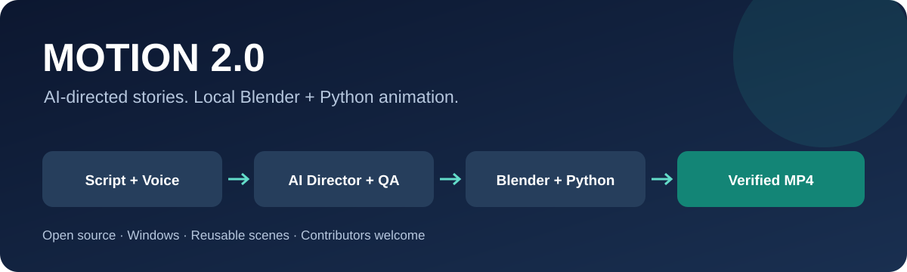

<p align="center"></p>

# Motion 2.0 — Turn Scripts & Voiceovers into Animated Videos

Turn a script and your recorded voiceover into a narrated motion video on Windows.
DeepSeek directs the scenes; Blender renders stylized people and their actions;
Python draws motion graphics, checks the result and assembles `OUTPUT/final.mp4`.

[](LICENSE)
[](#quick-start)
[](requirements.txt)
[](#requirements)
[](https://github.com/nirmallashkari/motion-2.0/actions/workflows/tests.yml)

**Help build better open-source script-to-video animation.** We need contributors
in Blender character animation, Python rendering, visual QA and developer experience.
[Find a starter task](https://github.com/nirmallashkari/motion-2.0/issues?q=is%3Aissue%20is%3Aopen%20label%3A%22good%20first%20issue%22)
or read [CONTRIBUTING.md](CONTRIBUTING.md).

## What it does

- One nonempty TXT line or one SRT cue becomes one scene, in source order.
- AI planning selects validated actions, props, cameras and locations from registered capabilities.
- Supported multi-character English narratives get story-specific cast designs, locked identities and Blender cast references.
- Human scenes use Blender; nonhuman graphics use Python/Pillow and licensed icon assets.
- Three sampled images per cast scene pass through bounded checks and API image review before full production.
- Fingerprinted caches allow verified clip reuse. Assembly checks decoded frames, FPS, codecs and supplied narration.
- Default delivery: 1280×720, 24 fps, H.264 video with AAC voiceover. Subtitles are off.
- A local Windows DPAPI credential backup protects the saved API key from an empty/missing text file. Credentials never belong in Git.

**Status: an experimental, working production pipeline with finite animation capabilities.**
It is not a general video foundation model. Arbitrary stories, natural acting,
perfect lip sync and universal high visual quality are not guaranteed.

## Quick start

### Requirements

1. Windows, [Python 3.13](https://www.python.org/downloads/) with the `py` launcher.
2. [Blender 5.1.1](https://download.blender.org/release/Blender5.1/). The host checks this exact version.
3. [FFmpeg](https://ffmpeg.org/download.html) with `ffmpeg` and `ffprobe` on PATH.
4. A DeepSeek account with API credit and access to the configured planning/image models.
   This release uses `deepseek-v4-pro` and `deepseek-flash`. It rejects unavailable models;
   changing providers/models requires adapting and testing the client contract.

There is no tested universal RAM/GPU minimum. Blender render speed varies with
hardware, scene complexity and duration. Start with a short script. Planning and
image review require internet and paid API access; scene rendering runs locally.

### Install and render

```powershell
git clone https://github.com/nirmallashkari/motion-2.0.git
cd motion-2.0
.\SETUP_MOTION.bat
```

If Blender is installed elsewhere, set `MOTION_BLENDER` to its executable before setup
and rendering. For example, in PowerShell:

```powershell
$env:MOTION_BLENDER = 'C:\Program Files\Blender Foundation\Blender 5.1\blender.exe'
```

After setup, paste **only your key on one line** into
`_SYSTEM/secrets/deepseek_api_key.txt` and save it. Do not put it in a script,
issue, screenshot or pull request. The entire secrets folder is Git-ignored.

Place exactly these two project inputs in `INPUT`:

```text
INPUT/
  script.txt       # or source.srt: one intended scene per line/cue
  voice.wav        # or MP3, M4A, FLAC, AAC, OGG
```

Run:

```powershell
.\RUN_VIDEO.bat
```

The completed narrated movie appears at **`OUTPUT/final.mp4`** after verification.
Reports and delivery evidence stay in `OUTPUT`; reusable cache stays in `_SYSTEM/work`.
The current workflow does not burn subtitles into the video. SRT is timing/source data.

For local speech recognition to improve TXT timing, install the optional dependency
set and pinned small speech model once (this setup download needs internet):

```powershell
.\SETUP_MOTION.bat -WithSpeech
```

Without speech weights, TXT uses explicitly labelled proportional timing estimates.
SRT preserves supplied cue times. Speech timestamps are estimates, not exact forced alignment.

To start a new project, `RESET_PROJECT.bat` requires typing `RESET` before clearing
INPUT, OUTPUT and work caches. Installed code, assets, models and secrets are preserved.

## How the pipeline works

```mermaid
flowchart LR
    A[Script + recorded voice] --> B[Source parsing + timing]
    B --> C[DeepSeek director]
    C --> D[Schema + registered capability checks]
    D --> E[Cast references + sampled previews]
    E --> F[Checks + API image review]
    F --> G[Local Blender / Python workers]
    G --> H[FFmpeg assembly + narration]
    H --> I[Verification + OUTPUT/final.mp4]
```



AI responses are data. Render workers cannot access the network; the active director
does not execute arbitrary API-authored Python. Invalid planning and unresolved review
defects stop the run. Read the production contract in [_SYSTEM/RULEBOOK.md](_SYSTEM/RULEBOOK.md).

## Current boundaries

| Area | Current behavior |
| --- | --- |
| Multiple characters | English role-word routing; 2–6 designed identities, at most 3 visible people per scene |
| Environments | Registered court, market, room, street and garden sets |
| Actions | Registered gestures and interactions, including coin choices, dialogue, chest reveal and departure |
| Other scripts | Existing hybrid concept/action route; unrecognized meaning may produce abstract graphics |
| TXT source length | 1–300 nonempty authored lines; voice duration is bounded to 4,500 seconds |
| Visual review | Sampled still-image review and technical heuristics; not continuous acting certification |
| Performance | Render workers can stall; automatic bounded stall recovery is a roadmap item |
| Languages | Hindi/English timing utilities exist; cast role routing is currently English-focused |

Old Ollama/Kaggle helper modules remain for regression compatibility. Their configurations
are disabled in this release. They are not required for the active DeepSeek BAT workflow.
Do not enable a historical route accidentally while debugging the active system.

## Developer map

| Path | Responsibility |
| --- | --- |
| `RUN_VIDEO.bat`, `_SYSTEM/bootstrap.ps1`, `_SYSTEM/motion.py` | Entry point and host orchestration |
| `_SYSTEM/deepseek_*`, `_SYSTEM/cast_*` | API broker, planning contracts, cast and review |
| `_SYSTEM/blender_*`, `_SYSTEM/python_worker.py` | Local trusted render workers |
| `_SYSTEM/framework/` | Canonical SDK, schemas, authoring checks and synthetic example |
| `_SYSTEM/tests/` | Regression tests, synthetic media tests and boundary tests |
| `_SYSTEM/assets/github/` | Licensed, pinned assets and provenance |
| `tools/` | Public setup, environment checks, speech download and publication checks |

No private narration, real story inputs, generated videos, API keys, encrypted backups,
installed virtual environments or model weights are included in this repository.

## Contribute

Start with [the contribution guide](CONTRIBUTING.md), [roadmap](ROADMAP.md) and
[open issues](https://github.com/nirmallashkari/motion-2.0/issues).
Useful work includes stronger face/pose animation, more reusable actions and props,
multilingual role detection, faster rendering and clearer progress/error reporting.

Run the regression suite after installing dependencies and FFmpeg:

```powershell
.\_SYSTEM\engines\python\.venv\Scripts\python.exe -m unittest discover -s _SYSTEM/tests -v
python tools/check_public_tree.py
```

The suite uses synthetic fixtures and mocked API calls; it does not require an API
key or spend API credit. A production render with API review is a separate check.
CI runs on Windows and includes FFmpeg-based integration tests; it does not certify
Blender visual quality or test a live provider account.

## Privacy and license

Planning sends script/context to DeepSeek, and image review sends rendered sample
images. Narration speech analysis is local. Review provider terms before submitting
sensitive material; keep project inputs and generated reports out of public issues.

Source: [MIT](LICENSE). Bundled assets retain their original licenses and notices:
[THIRD_PARTY_NOTICES.md](THIRD_PARTY_NOTICES.md).
